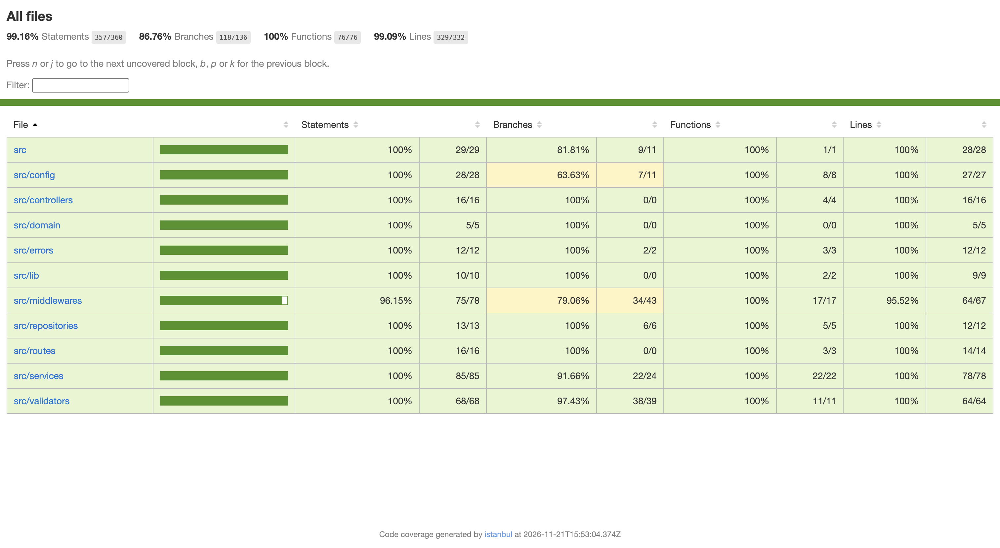

# Ionixx Order Splitter

A REST API for a robo-advisor's model-portfolio offering. A partner sends a user's
model portfolio and a total amount to **buy or sell**. The API responds with:

- the **amount** and **number of shares** for each stock in the portfolio,
- **when** the orders should be executed (markets open Monday to Friday), and
- the **history** of orders created since the application started.

Built with **Node.js + TypeScript + Express**. Data lives in memory and does not
survive a restart, as the brief requires.

---

## Contents

- [Quick start](#quick-start)
- [Configuration](#configuration)
- [Scripts](#scripts)
- [API](#api)
- [Business rules](#business-rules)
- [Architecture](#architecture)
- [Testing](#testing)
- [Dependencies](#dependencies)
- [Assumptions and limitations](#assumptions-and-limitations)

---

## Quick start

Prerequisites: **Node.js 20 or newer** (developed on Node 22; see `.nvmrc`) and npm.

```bash
git clone https://github.com/AnbazhaganThangaraj/ionixx-order-splitter.git
cd ionixx-order-splitter
npm install
npm run build
npm start            # http://localhost:3000
```

For development with auto-reload: `npm run dev`.

Every setting has a safe default, so no `.env` file is needed. To change settings,
copy `.env.example` to `.env` and edit it.

Interactive API docs (Swagger UI): **http://localhost:3000/docs**
(raw OpenAPI document: `/docs/openapi.json`).

---

## Configuration

| Variable              | Default            | Description                                                   |
| --------------------- | ------------------ | ------------------------------------------------------------- |
| `PORT`                | `3000`             | HTTP port                                                     |
| `NODE_ENV`            | `development`      | `development`, `test` or `production`                         |
| `LOG_LEVEL`           | `info`             | pino level (`silent` … `trace`)                               |
| `DEFAULT_STOCK_PRICE` | `100`              | Price (USD) used when the partner does not send `marketPrice` |
| `QUANTITY_PRECISION`  | `3`                | Decimal places allowed for share quantities (0–10), e.g. `7`  |
| `MARKET_TIMEZONE`     | `America/New_York` | IANA time zone of the exchange                                |
| `MARKET_OPEN_TIME`    | `09:30`            | Session open, `HH:mm`, in the exchange time zone              |
| `MARKET_CLOSE_TIME`   | `16:00`            | Session close, `HH:mm`, in the exchange time zone (exclusive) |

Configuration is validated on startup. If any value is invalid, the process prints
every problem and exits with code 1 instead of calculating with bad settings:

```text
$ QUANTITY_PRECISION=-1 npm start
Invalid configuration:
  - QUANTITY_PRECISION: Too small: expected number to be >=0
```

Changing the quantity precision from 3 to 7 is a configuration change only:

```bash
QUANTITY_PRECISION=7 npm start
```

---

## Scripts

| Command                 | What it does                                 |
| ----------------------- | -------------------------------------------- |
| `npm run dev`           | Start with auto-reload (tsx watch)           |
| `npm run build`         | Compile TypeScript to `dist/`                |
| `npm start`             | Run the compiled app (`node dist/server.js`) |
| `npm test`              | Run all unit and integration tests           |
| `npm run test:coverage` | Tests with a coverage report in `coverage/`  |
| `npm run lint`          | ESLint (strict, type-aware rules)            |
| `npm run typecheck`     | Type-check source and tests without emitting |
| `npm run format`        | Format with Prettier                         |

---

## API

Base path: `/api/v1`. All bodies are JSON. **Monetary values, percentages, prices and
quantities are decimal strings** (e.g. `"100.50"`). JSON numbers are accepted as input
too, but strings are preferred because JSON numbers are binary floating point.

| Method | Path                       | Purpose                            | Success |
| ------ | -------------------------- | ---------------------------------- | ------- |
| POST   | `/api/v1/orders`           | Calculate and create a split order | 201     |
| GET    | `/api/v1/orders`           | Order history, newest first, paged | 200     |
| GET    | `/api/v1/orders/{orderId}` | One order                          | 200     |
| GET    | `/health`                  | Health check                       | 200     |
| GET    | `/docs`                    | Swagger UI                         | 200     |

### Create an order

**Request fields**

| Field                     | Type           | Required | Rules                                                           |
| ------------------------- | -------------- | -------- | --------------------------------------------------------------- |
| `orderType`               | string         | yes      | `BUY` or `SELL`                                                 |
| `totalAmount`             | decimal string | yes      | > 0, at most 2 decimal places, at most 1,000,000,000            |
| `currency`                | string         | no       | `USD` (default and only supported value)                        |
| `portfolio`               | array          | yes      | 1–100 stocks                                                    |
| `portfolio[].symbol`      | string         | yes      | Ticker such as `AAPL` or `BRK.B`; upper-cased; must be unique   |
| `portfolio[].allocation`  | decimal string | yes      | Percent, > 0, at most 4 decimal places; all must sum to **100** |
| `portfolio[].marketPrice` | decimal string | no       | > 0; **overrides the default price** for that stock             |

Unknown fields are rejected, so a typo such as `markePrice` fails loudly instead of
silently falling back to the default price.

**Example: the scenario from the brief** (USD 100 into AAPL 60% / TSLA 40%)

```bash
curl -s -X POST http://localhost:3000/api/v1/orders \
  -H 'Content-Type: application/json' \
  -d '{
    "orderType": "BUY",
    "totalAmount": "100",
    "currency": "USD",
    "portfolio": [
      { "symbol": "AAPL", "allocation": "60" },
      { "symbol": "TSLA", "allocation": "40" }
    ]
  }'
```

Response `201 Created` (with `Location: /api/v1/orders/{orderId}`):

```json
{
  "orderId": "096eecb5-de2f-4469-be10-7490a1c222ac",
  "orderType": "BUY",
  "status": "SCHEDULED",
  "currency": "USD",
  "totalAmount": "100.00",
  "quantityPrecision": 3,
  "lines": [
    {
      "symbol": "AAPL",
      "allocationPercent": "60",
      "allocatedAmount": "60.00",
      "price": "100.00",
      "priceSource": "DEFAULT",
      "quantity": "0.600",
      "estimatedValue": "60.00",
      "residualAmount": "0.00"
    },
    {
      "symbol": "TSLA",
      "allocationPercent": "40",
      "allocatedAmount": "40.00",
      "price": "100.00",
      "priceSource": "DEFAULT",
      "quantity": "0.400",
      "estimatedValue": "40.00",
      "residualAmount": "0.00"
    }
  ],
  "totals": { "allocatedAmount": "100.00", "estimatedValue": "100.00", "residualAmount": "0.00" },
  "execution": {
    "executeAt": "2026-11-23T09:30:00.000-05:00",
    "timeZone": "America/New_York",
    "reason": "WEEKEND"
  },
  "warnings": [],
  "createdAt": "2026-11-21T15:52:32.053Z"
}
```

**Response fields per line**

- `allocatedAmount` – this stock's share of `totalAmount`, in cents
- `price` / `priceSource` – the price used and whether it came from the partner (`PARTNER`) or the default (`DEFAULT`); this is the price at the time the order was created
- `quantity` – shares to buy or sell, rounded **down** to `quantityPrecision`
- `estimatedValue` – `quantity × price`, in cents
- `residualAmount` – cash left over because the quantity was rounded down

**Example: partner prices and a SELL order**

```bash
curl -s -X POST http://localhost:3000/api/v1/orders \
  -H 'Content-Type: application/json' \
  -d '{
    "orderType": "SELL",
    "totalAmount": "250.00",
    "portfolio": [
      { "symbol": "AAPL", "allocation": "60", "marketPrice": "187.43" },
      { "symbol": "TSLA", "allocation": "40" }
    ]
  }'
```

AAPL uses the partner's 187.43 (`priceSource: "PARTNER"`, quantity `0.800`);
TSLA uses the default 100.00 (quantity `1.000`).

### List order history

```bash
curl -s 'http://localhost:3000/api/v1/orders?limit=10&offset=0&orderType=BUY'
```

| Query       | Default | Rules           |
| ----------- | ------- | --------------- |
| `limit`     | 20      | integer 1–100   |
| `offset`    | 0       | integer ≥ 0     |
| `orderType` | (all)   | `BUY` or `SELL` |

```json
{
  "data": [{ "orderId": "…", "orderType": "BUY", "…": "…" }],
  "pagination": { "limit": 10, "offset": 0, "total": 1 }
}
```

An empty history returns `200` with `"data": []`.

### Get one order

```bash
curl -s http://localhost:3000/api/v1/orders/096eecb5-de2f-4469-be10-7490a1c222ac
```

### Errors

Every error has the same shape:

```json
{
  "error": {
    "code": "VALIDATION_ERROR",
    "message": "Request validation failed",
    "details": [
      { "path": "portfolio", "message": "allocations must add up to exactly 100 (got 90)" },
      { "path": "portfolio[1].marketPrice", "message": "must be greater than 0" }
    ]
  },
  "requestId": "6f1c8d2e-0b7a-4f3e-9c41-2d5e8a7b9c10"
}
```

| Status | `code`                   | When                                                            |
| ------ | ------------------------ | --------------------------------------------------------------- |
| 400    | `VALIDATION_ERROR`       | Any rule above fails (all problems are listed at once)          |
| 400    | `INVALID_JSON`           | Body is not valid JSON                                          |
| 404    | `NOT_FOUND`              | Unknown order id or route                                       |
| 413    | `PAYLOAD_TOO_LARGE`      | Body larger than 100 kb                                         |
| 415    | `UNSUPPORTED_MEDIA_TYPE` | POST without `Content-Type: application/json`                   |
| 500    | `INTERNAL_ERROR`         | Unexpected failure; internal details are logged, never returned |

Every response carries an `X-Request-Id` header. A partner may send its own
`X-Request-Id` (letters, digits, `.`, `_`, `-`, up to 64 characters) and it is echoed
back and used in the logs.

### Response times in the console

Every request logs one structured JSON line with its duration in milliseconds,
measured with a monotonic clock (`performance.now()`):

```json
{
  "level": 30,
  "time": "2026-11-21T15:52:32.069Z",
  "service": "ionixx-order-splitter",
  "requestId": "ad9f9e7a-…",
  "method": "POST",
  "route": "/api/v1/orders",
  "statusCode": 201,
  "durationMs": 34.53,
  "msg": "POST /api/v1/orders 201 34.53ms"
}
```

Request bodies are never logged, because they describe a user's investments. For
coloured, human-readable logs during development: `npm run dev | npx pino-pretty`.

---

## Business rules

**1. Amount per stock.** `allocatedAmount = totalAmount × allocation ÷ 100`, in whole
cents. Every line except the last is rounded **down** to cents and the last line takes
whatever is left, so the lines always add up **exactly** to `totalAmount`.
Example: USD 100 at 33.3333 / 33.3333 / 33.3334 → 33.33 + 33.33 + 33.34.

**2. Price.** The partner's `marketPrice` if sent, otherwise `DEFAULT_STOCK_PRICE`
(USD 100). An invalid partner price (zero, negative, malformed) is **rejected**, never
silently replaced with the default.

**3. Quantity.** `quantity = allocatedAmount ÷ price`, rounded **down** to
`QUANTITY_PRECISION` decimal places, so an order never exceeds its amount. The unspent
cash is reported as `residualAmount` per line and in `totals`. If an allocation is too
small to trade even the smallest allowed fraction, the line has quantity `0` and the
order includes a warning.

**4. BUY and SELL** use the same maths: `totalAmount` is the value to buy or sell,
split by portfolio weight. Holdings are not part of the input, so SELL quantities are
not checked against what the user owns.

**5. Execution time.** Decided in the exchange time zone (default New York,
09:30–16:00, Monday–Friday):

| Order placed                 | Executes             | `reason`             |
| ---------------------------- | -------------------- | -------------------- |
| Weekday, before open         | Today at open        | `BEFORE_MARKET_OPEN` |
| Weekday, during market hours | Immediately          | `MARKET_OPEN`        |
| Weekday, at or after close   | Next weekday at open | `AFTER_MARKET_CLOSE` |
| Saturday or Sunday           | Monday at open       | `WEEKEND`            |

`executeAt` is an ISO-8601 timestamp with the exchange's UTC offset, and it handles
daylight-saving changes. **Public holidays are not considered** (see below).

**6. Exact arithmetic.** All money, percentage, price and quantity calculations use
`decimal.js`; JavaScript floating-point numbers are never used for these values.

---

## Architecture

Layered (MVC at the HTTP edge), with business logic kept out of controllers:

```text
HTTP request
  → middlewares   request id · response-time logging · JSON body parsing
  → routes        map method + path to a controller
  → controllers   validate input (Zod) · call the service · shape the response
  → services      OrderService (use cases)
                    ├─ OrderCalculator   (pure maths: split, price, quantity)
                    ├─ MarketScheduler   (when to execute)
                    └─ OrderRepository   (storage interface)
  → repositories  InMemoryOrderRepository (Map)
  → error middleware → consistent JSON error
```

Collaborators (repository, scheduler, clock, id generator, logger) are passed into
`createApp()`, so a database or a real exchange calendar can replace the POC versions
without changing the service, and tests can fix the clock.

```text
src/
├── app.ts                 # composition root: wires dependencies, builds the Express app
├── server.ts              # loads config, starts listening, graceful shutdown
├── config/                # environment schema, validated on startup
├── controllers/           # thin HTTP handlers
├── docs/                  # OpenAPI document
├── domain/                # Order types and enums
├── errors/                # AppError, ValidationError, NotFoundError
├── lib/                   # decimal.js setup, clock, logger
├── middlewares/           # request id, response time, JSON-only, 404, errors
├── repositories/          # OrderRepository interface + in-memory implementation
├── routes/                # orders, health, docs
├── services/              # order service, calculator, splitter, quantity, price, scheduler
└── validators/            # Zod schemas and the parse helper
tests/
├── unit/                  # config, validators, calculator parts, scheduler, repository
├── integration/           # HTTP tests with Supertest
├── fixtures/              # sample requests and orders
└── helpers/               # test app builder with log capture and fixed clock
```

---

## Testing

```bash
npm test                # 174 tests
npm run test:coverage   # coverage report in coverage/
```

### Coverage



Every function is covered, and over 99% of statements and lines. The uncovered
branches are mostly defensive fallbacks (for example, default values for settings that
are always present after validation, and body-parser error types that Express does not
produce in practice). Run `npm run test:coverage` and open `coverage/lcov-report/index.html`
to see the current report.

### What the tests cover

The tests focus on behaviour and edge cases:

- **Validation** – missing fields, wrong types, unsupported order types and currencies,
  allocations not summing to 100, duplicate symbols (any letter case), invalid partner
  prices, unknown fields, NaN/Infinity, decimal-place limits.
- **Calculation** – the brief's example, partner-price precedence, precision 0 / 3 / 7,
  rounding down, uneven splits, tiny amounts, residual cash, and invariants (lines
  always add up to the total; value never exceeds the amount).
- **Scheduler** – every weekday, exact open and close, weekends, dates that differ
  between UTC and New York, both daylight-saving transitions, a non-US market.
- **Repository** – empty history, newest-first ordering, paging, filtering, isolation
  of stored data, empty after "restart".
- **HTTP** – 201/200/400/404/413/415/500 responses, Location header, response-time log
  lines, request bodies not logged, request-id handling.

---

## Dependencies

**Runtime**

| Package              | Why                                                                     |
| -------------------- | ----------------------------------------------------------------------- |
| `express` (v5)       | HTTP framework; v5 forwards errors from async handlers automatically    |
| `zod` (v4)           | Request and configuration validation with typed results                 |
| `decimal.js`         | Exact decimal arithmetic for money and share quantities                 |
| `luxon`              | Time-zone and daylight-saving-aware date calculations for the scheduler |
| `pino`               | Fast structured JSON logging                                            |
| `swagger-ui-express` | Serves the interactive API documentation at `/docs`                     |
| `dotenv`             | Loads an optional `.env` file                                           |

**Development**

| Package                                     | Why                                       |
| ------------------------------------------- | ----------------------------------------- |
| `typescript`                                | Language and compiler (strict mode)       |
| `tsx`                                       | Runs TypeScript directly in `npm run dev` |
| `jest`, `ts-jest`                           | Test runner with TypeScript support       |
| `supertest`                                 | In-process HTTP integration tests         |
| `eslint`, `@eslint/js`, `typescript-eslint` | Linting with strict type-aware rules      |
| `prettier`, `eslint-config-prettier`        | Consistent formatting                     |
| `@types/*`                                  | Type definitions                          |

`npm audit` reports moderate advisories in packages used internally by Jest (test
tooling only; nothing in the running service). The suggested automatic fix downgrades
Jest, so it has not been applied.

---

## Assumptions and limitations

The full list, with reasoning, is in [ANSWERS.md](ANSWERS.md). In short:

- **No holiday calendar.** Weekdays only, as the brief states; a US market holiday
  such as Thanksgiving would still be scheduled. The scheduler is behind an interface
  so a real exchange calendar can replace it.
- **"Execute immediately" during market hours** means "at the request time"; this
  service calculates and schedules orders but does not place them with a broker.
- **USD only.** The fixed default price is a USD price.
- **SELL does not check holdings**, because holdings are not part of the input.
- **In-memory storage** by design: history is lost on restart, and it is per process
  (not shared between multiple instances).
- **No authentication** in this POC; see ANSWERS.md for production controls.
