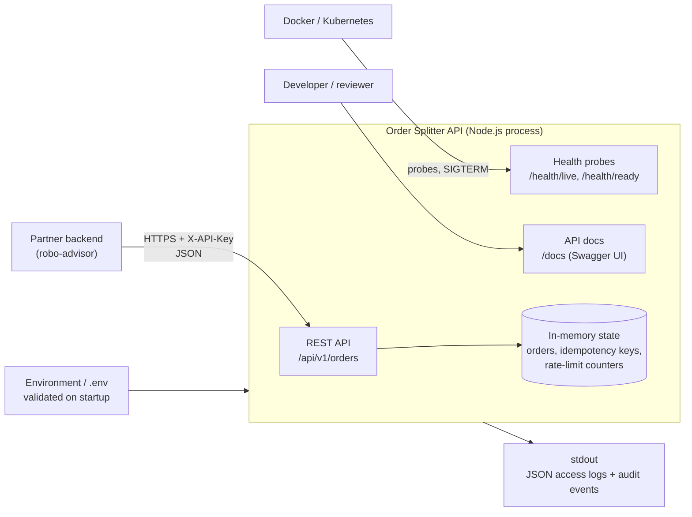
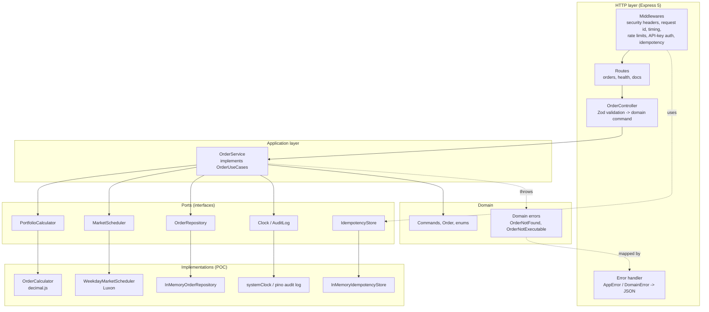
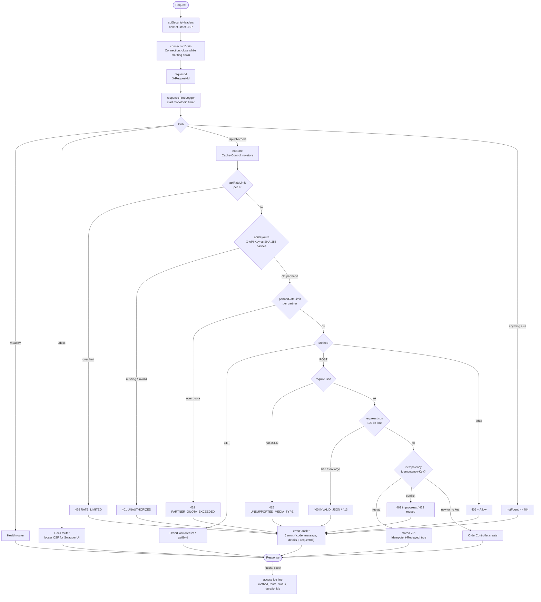
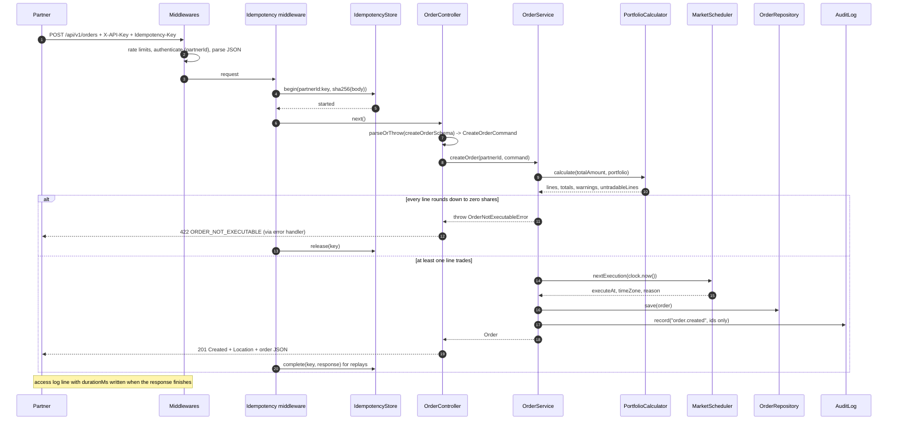
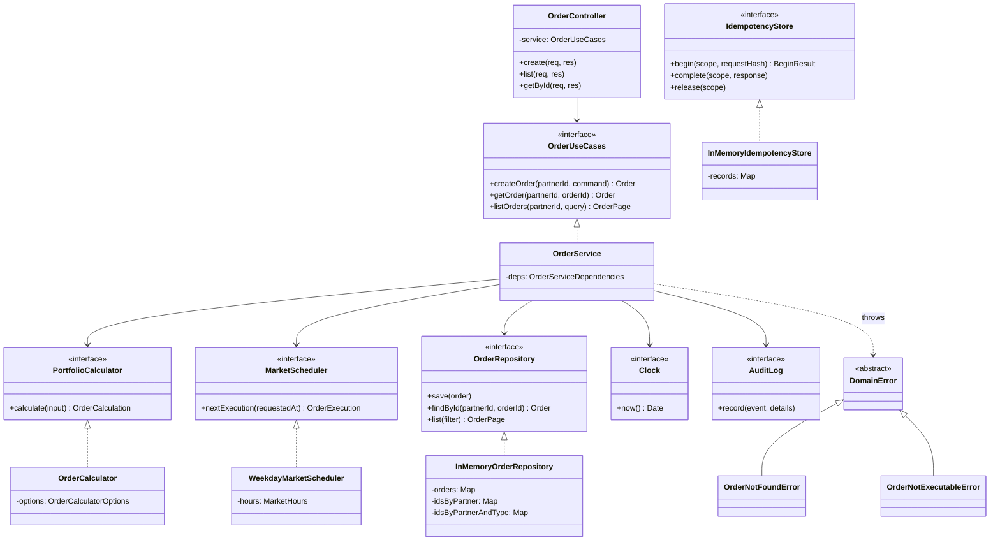
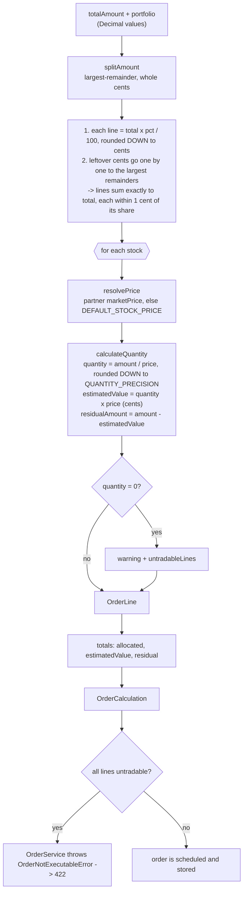
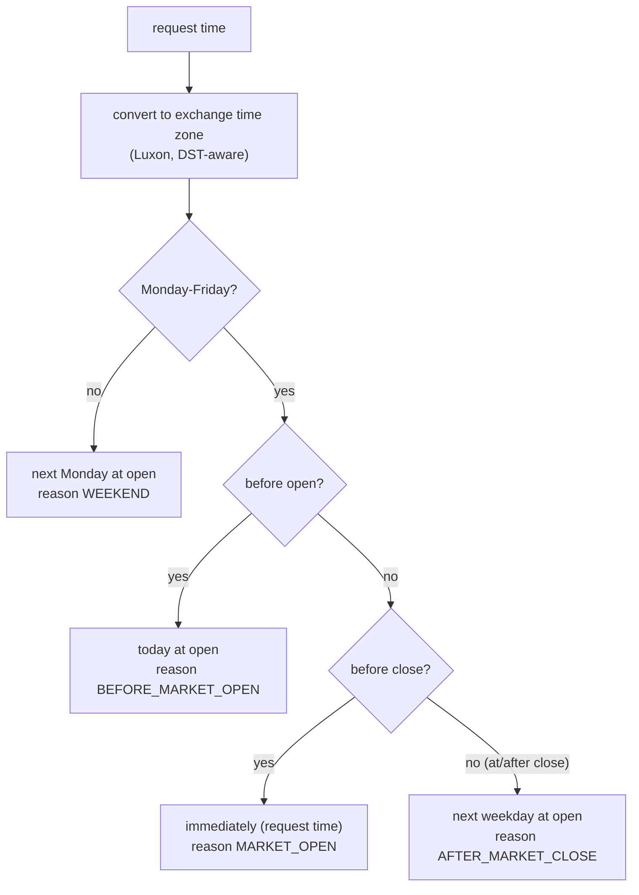
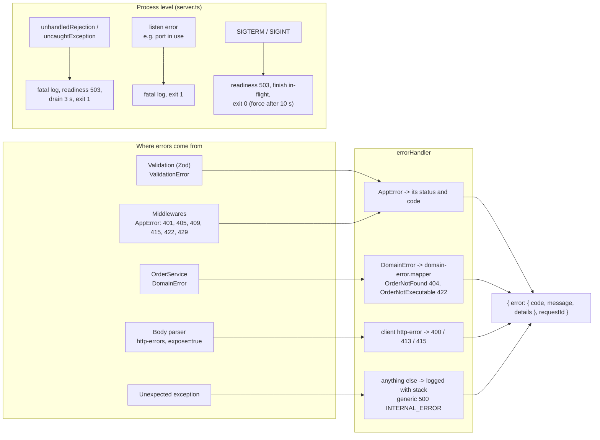
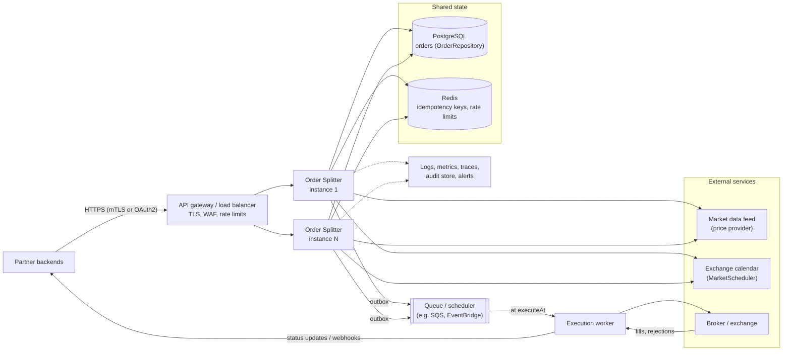

# Architecture

High-level design (HLD) shows the system and its main parts; low-level design (LLD) shows
how a request moves through the code and how the classes depend on each other. Diagrams
are written in [Mermaid](https://mermaid.js.org/) and render directly on GitHub. They
describe the code in `src/` as it is; the last section is a **proposed** production
target, not implemented here.

- [HLD 1 — System context](#hld-1--system-context)
- [HLD 2 — Components and layers](#hld-2--components-and-layers)
- [LLD 1 — Request pipeline](#lld-1--request-pipeline)
- [LLD 2 — Creating an order (sequence)](#lld-2--creating-an-order-sequence)
- [LLD 3 — Classes and interfaces](#lld-3--classes-and-interfaces)
- [LLD 4 — Order calculation](#lld-4--order-calculation)
- [LLD 5 — Execution time](#lld-5--execution-time)
- [LLD 6 — Error handling](#lld-6--error-handling)
- [Proposed production architecture](#proposed-production-architecture)

## HLD 1 — System context

A partner's backend calls the API over HTTPS. The service is a single Node.js process
with no external dependencies: state is in memory (the brief requires that data does not
survive a restart), and logs go to stdout.

## HLD 2 — Components and layers

Business logic sits in the service layer and depends only on interfaces (ports). The
concrete implementations are created in one place, `src/app.ts` (the composition root),
so storage or scheduling can be replaced without touching the use cases.

## LLD 1 — Request pipeline

Every request passes the global middlewares; `/api/v1/orders` adds the rate limits and
authentication. The body is parsed only on `POST`, **after** rate limiting and
authentication, so anonymous or throttled clients cannot make the server parse a body.
Any error at any step goes to the single error handler.

## LLD 2 — Creating an order (sequence)

The happy path of `POST /api/v1/orders` with an `Idempotency-Key`, after the middlewares
above have authenticated the partner.

## LLD 3 — Classes and interfaces

The service and controller depend on interfaces, never on concrete classes, which is
what lets tests use simple hand-written fakes and lets a database or exchange calendar
replace the POC implementations.

## LLD 4 — Order calculation

`OrderCalculator` composes three pure functions. All arithmetic uses `decimal.js`;
rounding is always explicit.

## LLD 5 — Execution time

`WeekdayMarketScheduler` decides in the exchange's time zone (default New York,
09:30–16:00), so the result is correct whatever the server's or partner's time zone and
across daylight-saving changes. Public holidays are not considered.

## LLD 6 — Error handling

Errors are created where they happen and presented in one place. Business rules raise
domain errors with no HTTP knowledge; the edge maps them. Failures outside any request
are handled at process level.

## Proposed production architecture

Not implemented: how the same design would run for real. Each change plugs into an
existing port, so the use cases stay the same.

